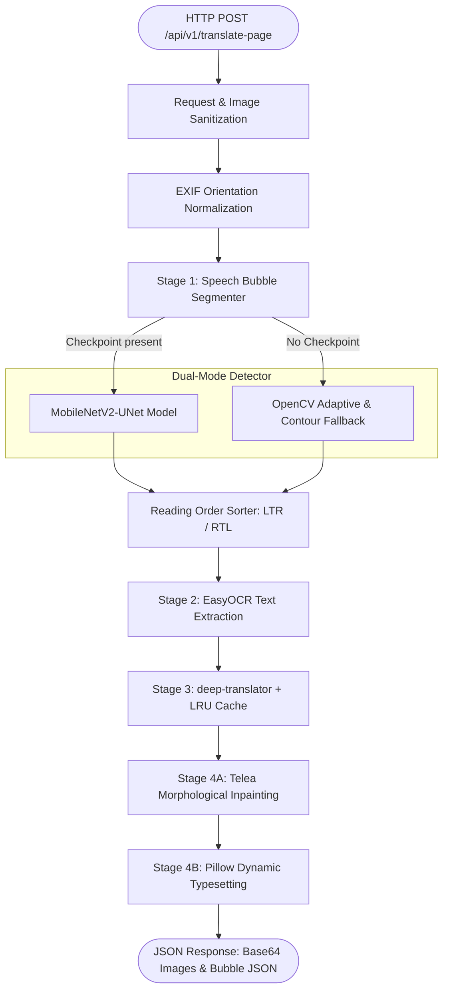

# ComicTypeset AI — Backend API & Docker Service

The ComicTypeset AI backend is a production-ready FastAPI service orchestrating speech bubble segmentation, text extraction (OCR), neural machine translation, lettering inpainting, and typography re-lettering.

Designed for deployment on **Hugging Face Docker Spaces** and local development environments.

---

## 1. Backend Architecture



---

## 2. API Contract

### 2.1 `GET /`
Returns a basic service status and the documentation path.

### 2.2 `GET /health`
Returns service availability, version, and the active segmentation detector mode.

**Response:**
```json
{
  "status": "ok",
  "version": "1.0.0",
  "detector_mode": "opencv_fallback",
  "model_loaded": false
}
```

---

### 2.3 `POST /api/v1/translate-page`
Processes a comic or manga page scan and returns the translated page, mask overlay, and extracted text.

**Multipart Form Parameters:**
- `file`: Image file (`image/png`, `image/jpeg`, `image/webp`). Max size: 15 MB.
- `source_lang`: Source language code (e.g., `"ja"`, `"en"`, `"auto"`). Default: `"auto"`.
- `target_lang`: Target language code (e.g., `"en"`, `"es"`, `"fr"`, `"ja"`). Default: `"en"`.
- `reading_direction`: Reading order direction (`"ltr"` or `"rtl"`). Default: `"ltr"`.

**Curl Example:**
```bash
curl -X POST "http://localhost:7860/api/v1/translate-page" \
  -F "file=@sample_page.png" \
  -F "source_lang=ja" \
  -F "target_lang=en" \
  -F "reading_direction=rtl"
```

**Response Example:**
```json
{
  "success": true,
  "detector_mode": "opencv_fallback",
  "reading_direction": "rtl",
  "source_lang": "ja",
  "target_lang": "en",
  "total_bubbles_detected": 2,
  "bubbles": [
    {
      "id": 1,
      "order": 1,
      "bbox": { "x": 300, "y": 60, "width": 150, "height": 90 },
      "raw_text": "こんにちは！",
      "translated_text": "Hello!",
      "confidence": 0.94,
      "polygon": [[300, 60], [450, 60], [450, 150], [300, 150]]
    }
  ],
  "final_image_base64": "data:image/png;base64,iVBORw0KGgoAAAANSUhEUgAA...",
  "mask_overlay_base64": "data:image/png;base64,iVBORw0KGgoAAAANSUhEUgAA...",
  "timings_ms": {
    "segmentation": 12.4,
    "ocr": 110.2,
    "translation": 45.6,
    "typesetting": 34.1,
    "total": 202.3
  },
  "warnings": []
}
```

---

## 3. Local Setup & Execution

### 3.1 Setup Virtual Environment (Windows)
```powershell
.\backend\setup_env.ps1
```

### 3.2 Run Backend Locally
```powershell
cd backend
python -m uvicorn app.main:app --reload --host 127.0.0.1 --port 7860
```
Open interactive Swagger documentation: `http://127.0.0.1:7860/docs`.

### 3.3 Run Unit Tests
```bash
cd backend
pytest -q
```

---

## 4. Docker Deployment (Hugging Face Spaces)

The backend includes a production-grade `Dockerfile` optimized for Hugging Face Docker Spaces:
- Pinned `python:3.11-slim` base image.
- Runs as non-root user `user` (UID 1000).
- Pre-configures writable `/home/user/.EasyOCR` directory.
- Exposes port `7860`.

### Build & Run Container Locally
```bash
cd backend
docker build -t comictypeset-api .
docker run -p 7860:7860 comictypeset-api
```
