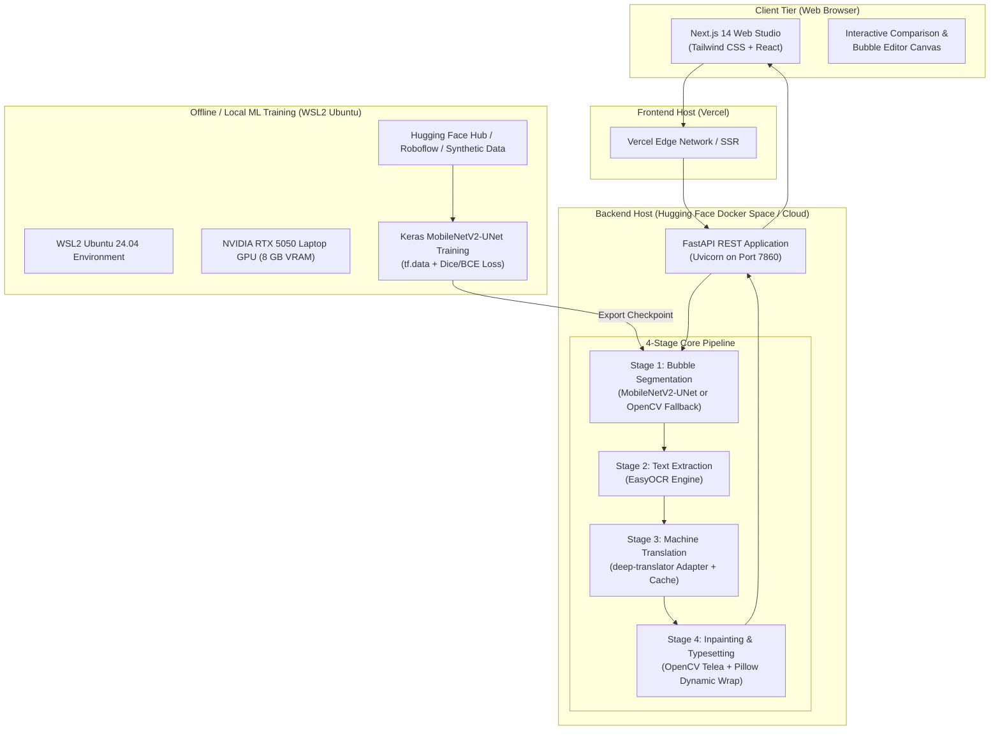
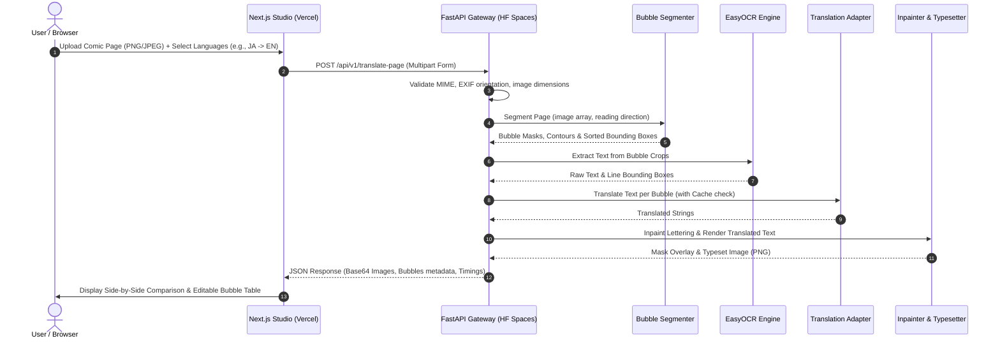

# System Architecture — ComicTypeset AI

## 1. Overview & System Boundaries

ComicTypeset AI is an autonomous, end-to-end comic and manga translation and re-lettering system. The system ingests raw comic or manga page scans, segments speech bubbles, extracts text using OCR, translates text into target languages, removes original lettering using image inpainting, and typesets translated text dynamically back into speech bubbles.

---

## 2. Runtime Environments & Isolation

To prevent dependency conflicts and maintain reproducibility across diverse operating environments, the system strictly separates execution contexts:

| Domain | Platform | Path | Main Dependencies | Primary Purpose |
| :--- | :--- | :--- | :--- | :--- |
| **Training** | WSL2 Ubuntu 24.04 | `ml_experiments/.venv` | `tensorflow[and-cuda]`, JupyterLab, Albumentations, OpenCV, PyYAML, `huggingface-hub`, `datasets` | Model development, hyperparameter tuning, GPU training, and dataset synthesis |
| **Backend API** | Windows / Linux / Docker | `backend/.venv` | `tensorflow-cpu`, FastAPI, Uvicorn, EasyOCR, `deep-translator`, OpenCV-headless, Pillow, pytest | REST API execution, CPU-optimized inference, inpainting, and typesetting |
| **Frontend UI** | Node.js / Vercel | `frontend/` | Next.js 14 (App Router), React 18+, TypeScript, Tailwind CSS, Lucide icons | User interface, drag-and-drop uploads, comparison preview, and interactive text editing |

---

## 3. Memory Budgets & Hardware Constraints

### 3.1 Local Development & GPU Training Budget
- **System RAM:** 24 GB DDR5.
- **GPU Accelerator:** NVIDIA GeForce RTX 5050 Laptop GPU (8 GB VRAM, Compute Capability 8.9+, CUDA 13.1).
- **VRAM Allocation Budget:**
  - Base TensorFlow Runtime: ~1.5 GB.
  - MobileNetV2-UNet Model Weights & Gradients: ~250 MB.
  - Forward/Backward Activation Buffer ($512 \times 512 \times 3$, Batch Size 8): ~2.8 GB.
  - Mixed Precision (`mixed_float16`) reduces peak activation overhead by ~40%.
  - Headroom for system OS and display buffers: ~3.0 GB.
- **Rule:** If batch size 8 exceeds available VRAM on complex augmentations, reduce batch size to 4 or input spatial dimension to $384 \times 384$.

### 3.2 Hugging Face Docker Space Runtime Budget (Free Tier)
- **CPU Architecture:** 2 vCPU Intel/AMD x86_64 (CPU inference mode).
- **System Memory (RAM):** 16 GB maximum.
- **Disk Space:** 50 GB container disk layer.
- **Cold-Start Allocation Plan:**
  - EasyOCR Model Weights (CRAFT detector + Latin/Japanese recognition models): ~120 MB loaded into `/home/user/.EasyOCR`.
  - MobileNetV2-UNet (or OpenCV Fallback): ~45 MB loaded into system RAM.
  - Peak per-request processing footprint: < 1.2 GB per $2048 \times 2048$ image.
  - Concurrency: Bounded by semaphore to 2 concurrent image pipelines to guarantee stability within 16 GB RAM.

---

## 4. Deployment Topology & Service Interaction

---

## 5. Security & Reliability Boundaries

1. **Input Sanitization:** Reject files exceeding 15 MB or pixel dimensions greater than $4096 \times 4096$ to prevent decompression bomb vulnerabilities (PIL `Image.MAX_IMAGE_PIXELS` safe ceiling).
2. **Data Privacy:** Raw uploaded images and extracted text are processed entirely in-memory and are never written to permanent disk storage or telemetry logs by default.
3. **CORS Governance:** Explicit origins permitted in production (e.g., production Vercel domain and local development host); wildcards disabled in production deployments.
4. **Graceful Fallbacks:** If the neural network model checkpoint (`bubble_unet.keras`) is absent, the backend automatically falls back to classical OpenCV contour and morphological bubble segmentation, signaling its active mode in the API response headers and payload.
