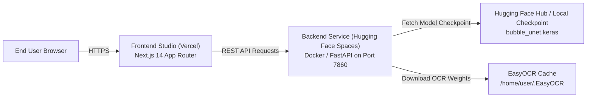

# Deployment Guide — ComicTypeset AI

This guide documents the procedures for deploying ComicTypeset AI across Hugging Face Docker Spaces (Backend API) and Vercel (Frontend Studio), managing model artifacts, and configuring operational parameters.

---

## 1. Architecture Topology



---

## 2. Backend Deployment: Hugging Face Docker Space

Hugging Face Spaces provides containerized hosting with 2 vCPU and 16 GB RAM on its free tier.

### 2.1 Space Configuration
The root of the Hugging Face Space repository requires a `README.md` starting with YAML metadata:

```yaml
---
title: ComicTypeset AI
emoji: 💬
colorFrom: indigo
colorTo: purple
sdk: docker
app_port: 7860
---
```

### 2.2 Dockerfile Constraints
The Docker container adheres to Hugging Face Spaces security guidelines:
- **Base image:** Pinned Debian-based image `python:3.11-slim`.
- **System packages:** `libgl1`, `libglib2.0-0` (required for OpenCV headless operations).
- **Non-root execution:** User `user` with UID `1000`.
- **Writable directories:** `/home/user/.EasyOCR` and `/home/user/.cache` created with `chown -R user:user`.
- **Exposed port:** Port `7860`.
- **Startup command:** `uvicorn app.main:app --host 0.0.0.0 --port 7860`.

### 2.3 Step-by-Step Backend Deployment
1. Create a new Space on [Hugging Face](https://huggingface.co/new-space):
   - Space Name: `comictypeset-api`
   - License: MIT / Apache 2.0
   - SDK: **Docker**
   - Hardware: **CPU Basic (2 vCPU, 16 GB RAM - Free)**
2. Clone the Space repository:
   ```bash
   git clone https://huggingface.co/spaces/<YOUR_USERNAME>/comictypeset-api
   ```
3. Copy the contents of `backend/` to the Space repository root.
4. Push to Hugging Face:
   ```bash
   git add .
   git commit -m "deploy: initial FastAPI backend on Docker"
   git push origin main
   ```
5. Monitor build logs in the Hugging Face Spaces console.

---

## 3. Frontend Deployment: Vercel

The frontend is an optimized Next.js 14 App Router application deployed on Vercel.

### 3.1 Step-by-Step Vercel Deployment
1. Push your repository to GitHub: `https://github.com/01mayankk/comictypeset-ai.git`.
2. In the [Vercel Dashboard](https://vercel.com), click **Add New Project** and import the repository.
3. Configure project settings:
   - **Root Directory:** `frontend`
   - **Framework Preset:** Next.js
   - **Build Command:** `next build`
   - **Output Directory:** `.next`
4. Set Environment Variables:
   - `NEXT_PUBLIC_API_URL`: `https://<YOUR_USERNAME>-comictypeset-api.hf.space` (or your local/custom backend domain).
5. Click **Deploy**.

---

## 4. Model Artifact Management & Hosting

The trained MobileNetV2-UNet model artifact is saved locally as:
`backend/models/bubble_unet.keras` (size: ~45 MB).

### Storage Guidelines:
1. **Local Development:** The `.keras` file resides in `backend/models/` and is strictly ignored by Git (`.gitignore`).
2. **Production Hosting Options:**
   - **Option A (Hugging Face Hub - Recommended):** Host the model artifact in a dedicated Hugging Face Model repository (e.g. `01mayankk/comictypeset-unet`). Download during container startup if absent.
   - **Option B (Git LFS):** Track `backend/models/*.keras` with Git Large File Storage.
3. **Graceful Fallback:** If `bubble_unet.keras` is not found, the backend executes the classical OpenCV contour detector without crashing.

---

## 5. Environment Variables Reference

| Variable | Scope | Default Value | Description |
| :--- | :--- | :--- | :--- |
| `PORT` | Backend | `7860` | Server listening port |
| `ALLOWED_ORIGINS` | Backend | `http://localhost:3000,https://*.vercel.app` | Comma-separated CORS whitelist |
| `MODEL_PATH` | Backend | `models/bubble_unet.keras` | Path to trained segmentation weights |
| `EASYOCR_MODULE_PATH` | Backend | `/home/user/.EasyOCR` | Writable directory for EasyOCR models |
| `NEXT_PUBLIC_API_URL` | Frontend | `http://127.0.0.1:7860` | Base URL of the backend API service |
| `ROBOFLOW_API_KEY` | Training | *(Optional)* | API key for Roboflow dataset acquisition |

---

## 6. Troubleshooting & Operational Runbook

| Symptom | Cause | Solution |
| :--- | :--- | :--- |
| `502 Bad Gateway` on HF Space | Uvicorn failed to bind to port 7860 | Verify `EXPOSE 7860` in Dockerfile and `--port 7860` in CMD |
| EasyOCR download fails | Non-root permission error writing to `~/.EasyOCR` | Ensure `RUN mkdir -p /home/user/.EasyOCR && chown -R 1000:1000 /home/user` in Dockerfile |
| Frontend displays CORS error | Origin not in backend `ALLOWED_ORIGINS` | Update `ALLOWED_ORIGINS` environment variable in Hugging Face Space settings |
| Out of Memory (OOM) during training | Batch size 8 exceeds 8 GB VRAM | Reduce `batch_size: 4` in `ml_experiments/config.yaml` or reduce image size to 384x384 |
| Missing OpenCV shared libraries | `libGL.so.1` missing in minimal Linux image | Install `libgl1` and `libglib2.0-0` via `apt-get` in Dockerfile |
