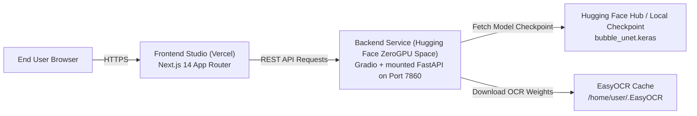

# Deployment Guide — ComicTypeset AI

This guide documents deploying ComicTypeset AI to a free Hugging Face ZeroGPU Space and Vercel, managing model artifacts, and configuring operational parameters.

---

## 1. Architecture Topology



---

## 2. Backend Deployment: Hugging Face Gradio ZeroGPU Space

The existing Space uses the Gradio SDK, which is required for ZeroGPU. Its Gradio landing page is mounted at `/gradio/`, while the FastAPI endpoints remain available at `/`, `/health`, `/docs`, and `/api/v1/translate-page`. The current TensorFlow U-Net and EasyOCR inference path runs on CPU; ZeroGPU acceleration is not implemented for this model.

### 2.1 Space Configuration
The root of the Hugging Face Space repository requires a `README.md` starting with YAML metadata:

```yaml
---
title: ComicTypeset AI
emoji: 💬
colorFrom: indigo
colorTo: purple
sdk: gradio
sdk_version: 6.32.0
python_version: 3.12.12
app_file: gradio_app.py
---
```

### 2.2 Step-by-Step Backend Deployment
1. Use the existing [ComicTypeset Space](https://huggingface.co/spaces/01mayankk/comic), configured with Gradio SDK and ZeroGPU hardware.
2. Clone the Space repository:
   ```bash
   git clone https://huggingface.co/spaces/01mayankk/comic
   ```
3. Copy the backend entrypoint, `README.md`, `requirements.txt`, `app/`, and `models/bubble_unet.keras` to the Space repository root. Store the model with Git LFS.
4. Push to Hugging Face:
   ```bash
   git add .
   git commit -m "deploy: update Gradio ZeroGPU backend"
   git push origin main
   ```
5. Monitor the Space build/runtime logs and verify `/health` reports `model_loaded: true` and `detector_mode: unet`.

---

## 3. Frontend Deployment: Vercel

The frontend is an optimized Next.js 14 App Router application deployed on Vercel.

### 3.1 Step-by-Step Vercel Deployment
1. Push your repository to GitHub: `https://github.com/01mayankk/comictypeset-ai.git`.
2. In the [Vercel Dashboard](https://vercel.com), click **Add New Project** and import the repository.
3. Configure project settings:
   - **Root Directory:** `frontend`
   - **Framework Preset:** Next.js
   - **Build Command:** `next build`
   - **Output Directory:** `.next`
4. Set Environment Variables:
   - `NEXT_PUBLIC_API_URL`: `https://01mayankk-comic.hf.space` (or your local/custom backend domain).
5. Click **Deploy**.
6. In Hugging Face Space settings, set `ALLOWED_ORIGINS` to the exact deployed Vercel origin.

---

## 4. Model Artifact Management & Hosting

The trained MobileNetV2-UNet model artifact is saved as
`backend/models/bubble_unet.keras` (about 97 MB).

### Storage Guidelines:
1. **Local Development:** The `.keras` file resides in `backend/models/` and is strictly ignored by Git (`.gitignore`).
2. **Production Hosting Options:**
   - **Option A (Hugging Face Hub - Recommended):** Host the model artifact in a dedicated Hugging Face Model repository (e.g. `01mayankk/comictypeset-unet`). Download during container startup if absent.
   - **Option B (Git LFS):** Track `backend/models/*.keras` with Git Large File Storage. The existing Space stores this checkpoint using LFS.
3. **Graceful Fallback:** If `bubble_unet.keras` is not found, the backend executes the classical OpenCV contour detector without crashing.

---

## 5. Environment Variables Reference

| Variable | Scope | Default Value | Description |
| :--- | :--- | :--- | :--- |
| `PORT` | Backend | `7860` | Server listening port |
| `ALLOWED_ORIGINS` | Backend | `http://localhost:3000,https://*.vercel.app` | Comma-separated CORS whitelist |
| `MODEL_PATH` | Backend | Backend-relative `models/bubble_unet.keras` | Path to trained segmentation weights |
| `EASYOCR_MODULE_PATH` | Backend | `/home/user/.EasyOCR` | Writable directory for EasyOCR models |
| `NEXT_PUBLIC_API_URL` | Frontend | `http://127.0.0.1:7860` | Base URL of the backend API service |
| `ROBOFLOW_API_KEY` | Training | *(Optional)* | API key for Roboflow dataset acquisition |

---

## 6. Troubleshooting & Operational Runbook

| Symptom | Cause | Solution |
| :--- | :--- | :--- |
| Space build or startup fails | Gradio entrypoint or dependency error | Check Space build/runtime logs, `sdk: gradio`, and `app_file: gradio_app.py` |
| EasyOCR download fails | Network or cache initialization error | Check Space runtime logs and available storage |
| Frontend displays CORS error | Origin not in backend `ALLOWED_ORIGINS` | Update `ALLOWED_ORIGINS` environment variable in Hugging Face Space settings |
| Out of Memory (OOM) during training | Batch size 8 exceeds 8 GB VRAM | Reduce `batch_size: 4` in `ml_experiments/config.yaml` or reduce image size to 384x384 |
