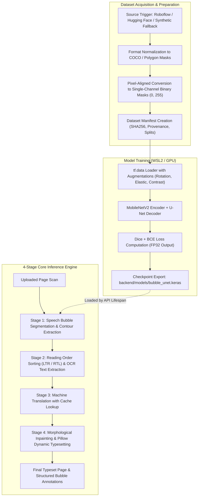

# Pipeline Flow — ComicTypeset AI

This document provides end-to-end specifications for the training pipeline and the 4-stage inference pipeline in ComicTypeset AI.

---

## 1. End-to-End Pipeline Overview



---

## 2. Dataset Acquisition Pipeline

The dataset acquisition script `ml_experiments/src/download_dataset.py` operates as an autonomous, multi-tier cascade:

```mermaid
flowchart TD
    Start([Execute download_dataset.py]) --> CheckRF{ROBOFLOW_API_KEY<br/>available?}
    CheckRF -- Yes --> FetchRF[Fetch dataset from Roboflow REST API]
    CheckRF -- No --> FetchHF[Fetch open dataset from Hugging Face Hub]
    
    FetchRF --> Norm{Download Succeeded?}
    FetchHF --> Norm
    
    Norm -- Yes --> Convert[Normalize Annotations to Binary PNG Masks {0, 255}]
    Norm -- No --> Fallback[Trigger synthetic_data_gen.py Fallback]
    
    Fallback --> Convert
    Convert --> Split[Partition into Deterministic 80/10/10 Splits]
    Split --> Manifest[Generate dataset_manifest.json with Checksums]
    Manifest --> Done([Dataset Ready for Training])
```

### Key Normalization Constraints:
- Image formats: Converted to RGB PNG.
- Mask formats: Grayscale 8-bit PNG where `0` = background and `255` = speech bubble interior.
- Alignment: Image and mask spatial dimensions must match $(W, H)$ with zero pixel deviation.

---

## 3. Four-Stage Inference Pipeline Details

```mermaid
sequenceDiagram
    autonumber
    participant Client
    participant API as FastAPI Router
    participant Seg as Stage 1: Segmenter
    participant OCR as Stage 2: OCR Engine
    participant Trans as Stage 3: Translator
    participant TS as Stage 4: Typesetter

    Client->>API: POST /api/v1/translate-page (Image, LTR/RTL, Langs)
    API->>Seg: segment_bubbles(image_rgb, reading_direction)
    Note over Seg: UNet Model or OpenCV Adaptive Fallback
    Seg-->>API: BubbleMasks, Contours, BoundingBoxes (sorted)

    API->>OCR: extract_text(image_rgb, sorted_bubbles, source_lang)
    Note over OCR: EasyOCR detects words & lines in each bubble crop
    OCR-->>API: Raw Text per Bubble + Confidence

    API->>Trans: translate_text(bubbles_text, source_lang, target_lang)
    Note over Trans: Check LRU cache; deep-translator fallback
    Trans-->>API: Translated Text per Bubble

    API->>TS: render_typeset(image_rgb, bubbles, translated_text)
    Note over TS: Inpaint text via cv2.inpaint, wrap & fit text with Pillow
    TS-->>API: final_image_bgr, mask_overlay_bgr

    API-->>Client: 200 OK JSON (Base64 images, Bubble JSON, timings)
```

### Stage 1: Speech Bubble Segmentation & Ordering
- **Model Check:** Checks for `backend/models/bubble_unet.keras`. If present, inputs are resized to $512 \times 512$, normalized to $[0, 1]$, and inferred. Output probability map is thresholded at $0.5$ and resized back to original page dimensions.
- **Fallback Mode:** If model is absent, applies adaptive Gaussian thresholding, morphological closing, and contour area filtering ($Area > 1500\text{ px}^2$, aspect ratio between $0.2$ and $5.0$).
- **Reading Order Sorting:**
  - **Left-to-Right (`ltr`):** Sorts bubbles by vertical band $Y$, then horizontal position $X$.
  - **Right-to-Left (`rtl`):** For Japanese manga, sorts from top-to-bottom, right-to-left ($X$ descending).

### Stage 2: Optical Character Recognition (OCR)
- Uses `EasyOCR` with specified language codes (e.g., `['en']`, `['ja']`).
- For each detected bubble contour, extracts the bounding box crop with a 4px inner padding.
- Runs text detection and recognition, concatenating detected lines and filtering low-confidence noise (< 0.2).

### Stage 3: Machine Translation
- Employs an adapter interface over `deep-translator` (Google Translate / DeepL).
- Memory-cached using an LRU cache keyed on `(source_lang, target_lang, text)`.
- Gracefully handles punctuation, ellipses, and common comic sound effects (SFX).

### Stage 4: Inpainting and Typesetting
1. **Lettering Inpainting:**
   - Detects text pixels inside each bubble using Otsu/adaptive thresholding or OCR bounding boxes.
   - Applies morphological dilation ($3 \times 3$ kernel, 2 iterations) to cover character edges.
   - Executes OpenCV Telea inpainting (`cv2.INPAINT_TELEA`) with radius 3.
2. **Dynamic Typesetting:**
   - Fits the translated text into the bubble's inscribed rectangular boundary.
   - Uses binary search to determine optimal font size ($8\text{pt}$ to $48\text{pt}$).
   - Wraps text lines greedily to maximize bubble fill while avoiding horizontal or vertical overflow.
   - Renders text centered horizontally and vertically with crisp sub-pixel antialiasing.
