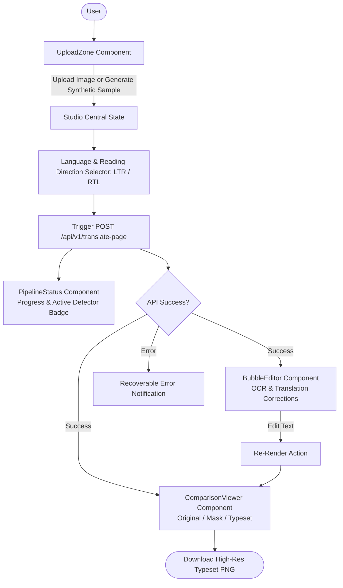

# ComicTypeset AI — Web Studio Frontend

A responsive Next.js 14 App Router studio for speech bubble detection, OCR correction, translation selection, and typeset comparison.

---

## 1. Application State & Component Flow



---

## 2. Component Directory

| Component | File | Responsibility |
| :--- | :--- | :--- |
| **`UploadZone`** | `src/components/UploadZone.tsx` | Drag-and-drop file upload, file validation, and client-side HTML5 canvas synthetic comic page generator. |
| **`ComparisonViewer`** | `src/components/ComparisonViewer.tsx` | Side-by-side or tabbed comparison of original page, red bubble mask overlay, and finished typeset artwork with PNG download. |
| **`BubbleEditor`** | `src/components/BubbleEditor.tsx` | Interactive table/list of detected speech bubbles showing reading order, original OCR text, translated text, and re-rendering. |
| **`PipelineStatus`** | `src/components/PipelineStatus.tsx` | Stage-by-stage pipeline progress indicator, timing breakdown, and active detector badge (`Trained U-Net` vs `OpenCV Fallback`). |

---

## 3. Local Development

### 3.1 Install Dependencies
```bash
cd frontend
npm install
```

### 3.2 Configure Environment
Create `.env.local` based on `.env.example`:
```env
NEXT_PUBLIC_API_URL=http://127.0.0.1:7860
```

### 3.3 Run Local Development Server
```bash
npm run dev
```
Open `http://localhost:3000` in your web browser.

---

## 4. Production Build & Vercel Deployment

### 4.1 Production Build & Lint Checks
```bash
npm run lint
npm run build
```

### 4.2 Vercel Deployment Settings
- **Framework Preset:** Next.js
- **Root Directory:** `frontend`
- **Build Command:** `npm run build`
- **Output Directory:** `.next`
- **Environment Variable:** `NEXT_PUBLIC_API_URL` set to your live Hugging Face Docker Space or cloud API URL.
